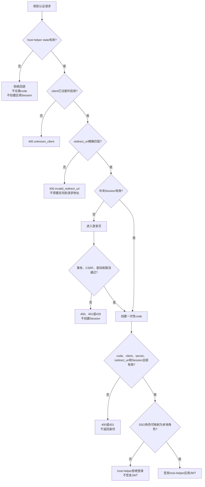

# 03-FEATURE zora-sso 完整认证流程

## 1. 参与方与会话边界

当前实现是内部授权码 POC，不是标准 OAuth 2.0 或 OpenID Connect Provider。整个认证过程包含
两套相互独立的会话：

| 会话 | 所属服务 | 用途 | 浏览器凭据 |
|---|---|---|---|
| 中央 SSO Session | zora-sso-server | 复用一次登录结果，为已注册客户端签发一次性授权码 | `ZORA_SSO_SESSION` Cookie |
| 应用 Session | host-helper-server | 访问 host-helper 页面和 REST API | host-helper 配置的 HttpOnly JWT Cookie |

浏览器不能读取 Client Secret，也不会接触 zora-sso 返回的身份 JSON。Client Secret 和授权码
兑换只发生在 host-helper-server 与 zora-sso-server 之间。

## 2. 首次登录完整时序

```mermaid
sequenceDiagram
    autonumber
    actor U as 用户
    participant B as 浏览器
    participant HS as host-helper<br/>SecurityHandler
    participant HA as host-helper<br/>SsoAuthenticationHandler
    participant ST as host-helper<br/>Pending State Store
    participant ZW as zora-sso<br/>SsoHandler
    participant ZS as zora-sso<br/>SsoService
    participant ID as zora-sso<br/>IdentityAuthenticator
    participant HC as host-helper<br/>ZoraSsoClient

    U->>B: 打开 host-helper 受保护页面
    B->>HS: GET /hosthelper/index.html<br/>Cookie: host-helper应用Cookie（首次访问时缺失）
    HS-->>B: 302 Found<br/>Location: /auth/sso/login

    B->>HA: GET /auth/sso/login
    HA->>ST: 生成并保存256位随机state<br/>保存时间默认5分钟，且只能消费一次
    ST-->>HA: state
    HA-->>B: 302 Found<br/>Location: {ssoBaseUri}/authorize?<br/>client_id={clientId}&<br/>redirect_uri={redirectUri}&<br/>state={state}

    B->>ZW: GET /authorize<br/>Query: client_id, redirect_uri, state<br/>Cookie: ZORA_SSO_SESSION（首次登录时缺失）
    ZW->>ZS: beginAuthorization(request, sessionId)
    ZS->>ZS: 校验client已注册且enabled=true<br/>redirect_uri必须精确匹配<br/>state非空且长度不超过512
    ZS->>ZS: 创建登录事务<br/>transactionId有效期默认5分钟
    ZS-->>ZW: loginRequired(transactionId)
    ZW-->>B: 302 Found<br/>Location: /login?transaction_id={transactionId}

    B->>ZW: GET /login?transaction_id={transactionId}
    ZW->>ZS: prepareLogin(transactionId)
    ZS->>ZS: 校验事务并生成独立csrfToken
    ZS-->>ZW: transactionId, csrfToken, clientId
    ZW-->>B: 200 OK text/html<br/>隐藏字段: transaction_id, csrf_token<br/>输入字段: username, password

    U->>B: 输入用户名和密码
    B->>ZW: POST /login<br/>Content-Type: application/x-www-form-urlencoded<br/>transaction_id={transactionId}&<br/>csrf_token={csrfToken}&<br/>username={username}&<br/>password={password}
    ZW->>ZS: login(transactionId, csrfToken,<br/>username, password, sourceIp)
    ZS->>ZS: 校验事务、CSRF和登录限流
    ZS->>ID: authenticate(username, password)
    ID-->>ZS: AuthenticatedIdentity或认证失败
    ZS->>ZS: 创建中央Session<br/>空闲超时默认2小时<br/>绝对超时默认8小时
    ZS->>ZS: 创建一次性opaque code<br/>默认30秒过期
    ZS-->>ZW: sessionId与回调URI
    ZW-->>B: 302 Found<br/>Set-Cookie: ZORA_SSO_SESSION={sessionId}<br/>Path=/, HttpOnly, SameSite=Lax, Secure按配置启用<br/>Location: {redirectUri}?code={code}&state={state}

    B->>HA: GET /auth/sso/callback?<br/>code={code}&state={state}
    HA->>ST: 单次消费并校验state
    ST-->>HA: state有效
    HA->>HC: exchange(code)

    HC->>ZW: POST /sso/token/exchange<br/>Content-Type: application/x-www-form-urlencoded<br/>code={code}&<br/>client_id={clientId}&<br/>client_secret={clientSecret}&<br/>redirect_uri={固定redirectUri}
    ZW->>ZS: exchange(code, clientId,<br/>clientSecret, redirectUri)
    ZS->>ZS: 校验Client Secret哈希<br/>校验client启用状态<br/>校验code未过期且未消费<br/>校验code绑定的client和redirect_uri<br/>校验中央Session仍有效
    ZS->>ZS: 原子消费一次性code
    ZS-->>ZW: AuthenticatedIdentity
    ZW-->>HC: 200 OK application/json<br/>RestResponse&lt;AuthenticatedIdentity&gt;
    HC-->>HA: SsoIdentity

    HA->>HA: 按允许列表映射SSO角色<br/>构建AppSecurityContext<br/>签发host-helper本地JWT
    HA-->>B: 302 Found<br/>Set-Cookie: host-helper应用Cookie={JWT}<br/>Path=/, HttpOnly, SameSite=Lax, Secure按配置启用<br/>Location: /hosthelper/index.html

    B->>HS: GET /hosthelper/index.html<br/>Cookie: host-helper应用Cookie={JWT}
    HS->>HS: 校验JWT签名、有效期和安全上下文
    HS-->>B: 200 OK<br/>host-helper页面
```

## 3. 每个请求的完整契约

### 3.1 访问 host-helper 受保护资源

```http
GET /hosthelper/index.html
Cookie: <host-helper-cookie-name>=<application-jwt>
```

首次访问或 Cookie 无效时：

```http
HTTP/1.1 302 Found
Location: /auth/sso/login
```

JWT 有效时继续执行原请求。host-helper 的页面处理器和 REST 安全过滤器只信任经过本地 JWT
校验后生成的 `AppSecurityContext`。

### 3.2 host-helper 发起 SSO 登录

```http
GET /auth/sso/login
```

host-helper 生成不可预测的随机 `state`，服务端保存后返回：

```http
HTTP/1.1 302 Found
Location: <sso-base-uri>/authorize?client_id=<client-id>&redirect_uri=<encoded-redirect-uri>&state=<state>
```

| 参数 | 来源 | 约束 |
|---|---|---|
| `client_id` | host-helper 配置 | 必须对应 zora-sso 中已启用的注册客户端 |
| `redirect_uri` | host-helper 配置 | 不接受浏览器覆盖，必须与注册值完全相同 |
| `state` | host-helper 随机生成 | 256 位随机值、默认五分钟过期、单次消费 |

### 3.3 zora-sso 授权入口

```http
GET /authorize?client_id=<client-id>&redirect_uri=<encoded-redirect-uri>&state=<state>
Cookie: ZORA_SSO_SESSION=<central-session-id>
```

中央 Session 缺失时：

```http
HTTP/1.1 302 Found
Location: /login?transaction_id=<transaction-id>
```

中央 Session 有效时跳过登录页面，直接签发新的授权码：

```http
HTTP/1.1 302 Found
Location: <registered-redirect-uri>?code=<one-time-code>&state=<original-state>
```

授权码是随机 opaque 值，不包含可由客户端解析的身份信息。授权码默认 30 秒过期，并绑定：

- `client_id`
- 完整 `redirect_uri`
- 中央 Session
- 已认证身份

### 3.4 获取登录页面

```http
GET /login?transaction_id=<transaction-id>
```

成功响应：

```http
HTTP/1.1 200 OK
Content-Type: text/html; charset=utf-8
Cache-Control: no-store
Pragma: no-cache
X-Content-Type-Options: nosniff
X-Frame-Options: DENY
Content-Security-Policy: default-src 'none'; style-src 'unsafe-inline'; form-action 'self'; frame-ancestors 'none'
```

HTML 表单包含：

| 字段 | 类型 | 说明 |
|---|---|---|
| `transaction_id` | hidden | 对应授权请求，默认五分钟过期 |
| `csrf_token` | hidden | 每次准备登录页面时生成的随机 CSRF Token |
| `username` | text | 最大长度 128 |
| `password` | password | 最大长度 1024 |

### 3.5 提交用户名和密码

```http
POST /login
Content-Type: application/x-www-form-urlencoded

transaction_id=<transaction-id>&csrf_token=<csrf-token>&username=<username>&password=<password>
```

成功响应：

```http
HTTP/1.1 302 Found
Set-Cookie: ZORA_SSO_SESSION=<session-id>; Path=/; Max-Age=7200; SameSite=Lax; HttpOnly[; Secure]
Location: <registered-redirect-uri>?code=<one-time-code>&state=<original-state>
```

安全约束：

- 登录事务和 CSRF Token 必须同时匹配。
- 密码验证后立即覆盖内存中的字符数组。
- 相同“用户名 + 来源 IP”在五分钟内最多失败五次。
- 中央 Session 默认空闲两小时、绝对有效期八小时。
- 非本机环境必须通过 HTTPS，并启用 Secure Cookie。

### 3.6 host-helper 回调

```http
GET /auth/sso/callback?code=<one-time-code>&state=<state>
```

| 参数 | 必填 | 校验 |
|---|---|---|
| `code` | 是 | 非空，仅发送给 zora-sso 后端兑换接口 |
| `state` | 是 | 必须匹配 host-helper 服务端保存的待处理状态，并单次消费 |

浏览器提供的参数不能覆盖 `client_id`、Client Secret 或 `redirect_uri`。state 缺失、过期、不匹配
或已经消费时，host-helper 拒绝登录，不签发本地 Cookie。

### 3.7 host-helper 后端兑换身份

```http
POST /sso/token/exchange
Content-Type: application/x-www-form-urlencoded

code=<one-time-code>&client_id=<client-id>&client_secret=<client-secret>&redirect_uri=<registered-redirect-uri>
```

host-helper 对该请求执行以下客户端侧限制：

- 使用配置中的 zora-sso 地址、Client ID、Client Secret 和回调 URI。
- Client Secret 只存在于后端配置和请求中。
- 禁止跟随 HTTP 重定向。
- 使用配置的连接超时和请求超时。
- 限制响应体最大字节数。
- 要求响应 `Content-Type` 为 JSON。

成功响应：

```json
{
  "success": true,
  "data": {
    "subject": "user-1",
    "username": "alice",
    "displayName": "Alice",
    "roles": [
      "USER"
    ],
    "authenticatedAt": "2026-10-11T10:00:00Z"
  },
  "message": null
}
```

字段说明：

| 字段 | 说明 |
|---|---|
| `success` | 成功响应固定为 `true` |
| `data.subject` | SSO 稳定用户标识，host-helper 应将其作为外部身份主键 |
| `data.username` | 登录用户名 |
| `data.displayName` | 用户显示名称 |
| `data.roles` | zora-sso 返回的角色集合，必须经过 host-helper 允许列表映射 |
| `data.authenticatedAt` | 本次中央认证完成时间，ISO-8601 UTC 时间 |
| `message` | 成功时固定为 `null` |

失败响应采用统一结构：

```json
{
  "success": false,
  "data": null,
  "message": "Invalid or expired authorization code"
}
```

常见状态码：

| HTTP 状态 | 场景 |
|---|---|
| `400 Bad Request` | 请求字段缺失、格式错误或回调 URI 不合法 |
| `401 Unauthorized` | Client Secret 错误、授权码无效或过期、中央 Session 失效 |
| `429 Too Many Requests` | 登录失败次数超过限制 |
| `500 Internal Server Error` | 未处理的服务端异常，host-helper 必须按登录失败处理 |

### 3.8 host-helper 创建应用 Session

兑换成功后，host-helper：

1. 检查 `subject`、用户名、角色和认证时间等身份字段。
2. 按 `sso.role-mappings` 将 SSO 角色映射为 host-helper 本地角色。
3. 未配置映射或映射结果为空时默认拒绝。
4. 构建本地 `AppSecurityContext`。
5. 使用 host-helper 自己的密钥签发本地 JWT。
6. 通过 HttpOnly Cookie 返回本地 JWT，然后跳转到 `/hosthelper/index.html`。

默认角色映射：

| SSO 角色 | host-helper 角色 |
|---|---|
| `USER` | `read` |
| `ADMIN` | `admin`、`read`、`write` |

此后访问 host-helper 不再携带 `ZORA_SSO_SESSION` 给 host-helper，也不会在每个业务请求中访问
zora-sso。host-helper 只校验自己的应用 JWT。

## 4. 已有中央 Session 时的免密流程

```mermaid
sequenceDiagram
    autonumber
    actor U as 用户
    participant B as 浏览器
    participant H as host-helper-server
    participant S as zora-sso-server

    U->>B: 再次进入host-helper登录流程
    B->>H: GET /auth/sso/login
    H-->>B: 302 /authorize?client_id&redirect_uri&state
    B->>S: GET /authorize<br/>Cookie: ZORA_SSO_SESSION={有效Session}
    S->>S: 校验Session并滑动更新空闲过期时间
    S->>S: 直接签发新的30秒一次性code
    S-->>B: 302 {redirectUri}?code={code}&state={state}
    B->>H: GET /auth/sso/callback?code&state
    H->>S: POST /sso/token/exchange<br/>code, client_id, client_secret, redirect_uri
    S-->>H: 200 RestResponse&lt;AuthenticatedIdentity&gt;
    H-->>B: Set-Cookie: host-helper应用JWT<br/>302 /hosthelper/index.html
```

该流程不会再次发送用户名和密码，也不会复用旧授权码。每个客户端、每次登录仍会获得新的
一次性授权码和新的 host-helper 本地 Session。

## 5. 失败分支



默认拒绝原则：任何参数、事务、凭据、会话、角色映射或响应格式不能验证时，都不能创建成功
形态的身份或应用 Session。

## 6. 登出边界

zora-sso 中央登出接口：

```http
POST /sso/logout
Cookie: ZORA_SSO_SESSION=<central-session-id>
```

成功响应：

```http
HTTP/1.1 200 OK
Set-Cookie: ZORA_SSO_SESSION=; Path=/; Max-Age=0; SameSite=Lax; HttpOnly[; Secure]
Content-Type: application/json
```

```json
{
  "success": true,
  "data": {
    "loggedOut": true
  },
  "message": null
}
```

清除中央 Session 不会自动撤销已经签发的 host-helper 本地 JWT；清除 host-helper 本地 Cookie
也不会自动清除中央 SSO Session。完整单点登出需要显式终止这两层会话，当前实现应将它们视为
两个独立的安全边界。

## 7. 不应出现在日志或浏览器中的信息

- Client Secret 明文及其 PBKDF2 哈希。
- 用户密码。
- 完整授权码。
- 中央 Session ID。
- host-helper 本地 JWT。
- 登录事务的 CSRF Token。
- 未经脱敏的身份兑换响应。

请求日志可以记录方法、路径、状态码和耗时，但不得记录上述查询参数、表单值、Cookie 或响应
正文。
